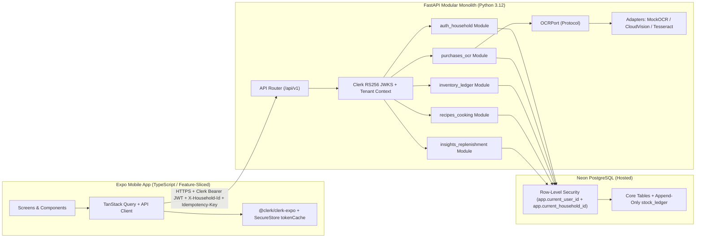
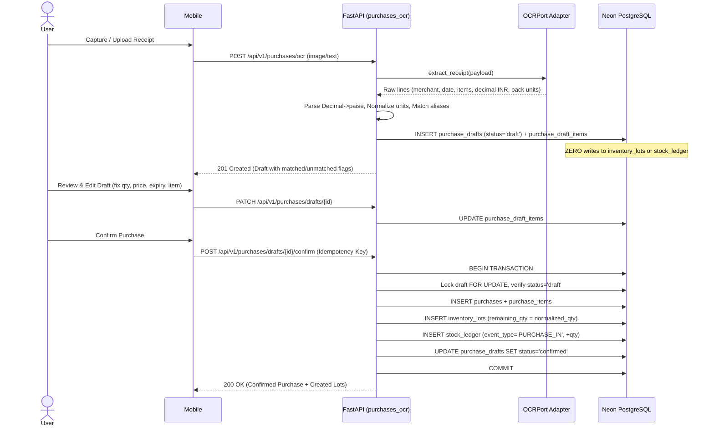
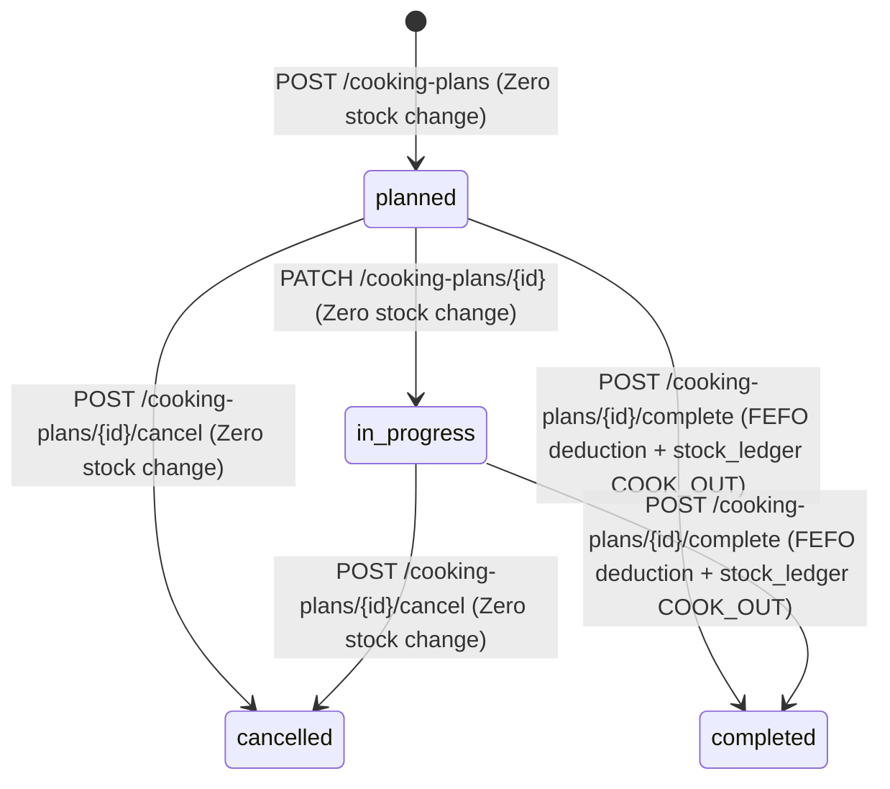

# System Architecture — GroceryManagement-AgentBenchmark

**Status:** Phase 1 Approved Specification  
**Target Stack:** FastAPI (Python 3.12+) + Expo / React Native (TypeScript) + Neon PostgreSQL (Hosted)  
**Architectural Style:** Modular Monolith (Backend) + Feature-Sliced Client (Mobile) + Port/Adapter OCR Boundary

---

## 1. Architectural Overview & Design Goals

GroceryManagement-AgentBenchmark is a household grocery inventory, receipt-to-stock ingestion, FEFO lot tracking, recipe recommendation, cooking execution, and replenishment insights platform.

### Core Design Principles
1. **Server-Side Authority**: All business invariants (FEFO deduction, ledger immutability, household isolation, unit normalization, monetary integer math) are enforced exclusively on the backend and PostgreSQL.
2. **Zero Heavyweight Local Infrastructure**: The authoritative database is hosted **Neon PostgreSQL**. Neither local Docker containers nor local ML/embedding runtimes (e.g., PyTorch, `pgvector`, local LLM weights) are required to run or test the backend or mobile app.
3. **Independent Runnability**: The FastAPI backend (`backend/`) and Expo mobile app (`mobile/`) are decoupled via a versioned REST API (`/api/v1`) and can be started, tested, and deployed independently.
4. **Explicit Draft-Review-Confirm Ingestion**: OCR extraction is untrusted input. It produces a mutable draft that requires explicit human confirmation before mutating inventory or financial purchase records.
5. **Append-Only Auditability**: Every inventory quantity change is recorded in an immutable `stock_ledger` table synchronized with `inventory_lots`.

---

## 2. High-Level System Topology



---

## 3. Module Boundaries & Dependency Rules

### 3.1 Backend Modular Monolith (`backend/app/`)
The backend is organized into cohesive domain modules. **Cross-module communication happens only through module service interfaces (never direct table queries across module boundaries).**

| Module | Directory | Responsibility | Owned Tables |
| :--- | :--- | :--- | :--- |
| `core` | `app/core/` | Config, Neon async SQLAlchemy/psycopg pool, `PyJWT[crypto]` + `httpx` JWKS `RS256` verification, RLS session setter, error envelope, idempotency middleware | `idempotency_keys` |
| `auth_household` | `app/modules/auth/` | Clerk user upsert (`SECURITY DEFINER` `upsert_clerk_user`), `GET /auth/me` auto-bootstrap, household creation/membership, RBAC | `users`, `households`, `household_members` |
| `catalog` | `app/modules/catalog/` | Canonical grocery items, deterministic alias resolution, unit conversion rules | `canonical_items`, `item_aliases` |
| `purchases_ocr` | `app/modules/purchases/` | Receipt image upload metadata, OCR port/adapter invocation, draft creation/editing, atomic confirm | `purchase_drafts`, `purchase_draft_items`, `purchases`, `purchase_items` |
| `inventory_ledger` | `app/modules/inventory/` | Lot creation, FEFO advisory-locked deduction, manual adjustment, expiry/spoilage write-off, ledger queries | `inventory_lots`, `stock_ledger` |
| `recipes_cooking` | `app/modules/recipes/` | Recipe catalog, inventory-backed recommendation scoring, cooking plan lifecycle (`planned` -> `completed`/`cancelled`) | `recipes`, `recipe_ingredients`, `cooking_plans`, `cooking_plan_items` |
| `insights_replenishment` | `app/modules/insights/` | Spend analytics (in integer paise), waste/expiry metrics, low-stock & consumption-rate replenishment suggestions | Read-only views/queries over `purchases`, `inventory_lots`, `stock_ledger` |

**Dependency Direction Rule:**
- `api` (FastAPI routers + Pydantic schemas) -> `modules/*/service.py` -> `modules/*/repository.py` -> `core/db.py`.
- `purchases_ocr` calls `inventory_ledger.service.create_lot_from_purchase(...)` on confirm.
- `recipes_cooking` calls `inventory_ledger.service.deduct_fefo(...)` on cooking completion.
- `inventory_ledger` never depends on `purchases_ocr` or `recipes_cooking`.

### 3.2 Mobile Feature-Sliced Client (`mobile/src/`)
- `app/`: Expo Router screens (thin composition only) using `<SignedIn>` / `<SignedOut>` auth gating and 5 primary navigation tabs: `Home`, `Inventory`, `Purchases`, `Recipes`, `Settings`.
- `features/`: `auth` (`@clerk/clerk-expo` + `useSSO()`), `purchases` (camera/receipt review), `inventory` (lots & ledger), `recipes` (recommendations & cooking mode), `insights` (spend & replenishment on `Home`), `settings` (household switcher & preferences).
- `shared/`: Typed API client (`fetch` wrapper with Clerk `getToken()` Bearer injection, `X-Household-Id` header, `Idempotency-Key` generation, uniform error parsing), `expo-secure-store` `tokenCache`, currency formatter (`paise -> ₹`), unit formatter (`g/ml/pcs`), design tokens.

---

## 4. Phase 0 Disagreement Resolutions (Explicit Rationale & Trade-Offs)

### 4.1 Disagreement #2: `pgvector` and `pg_trgm` Necessity
- **Decision**:
  - **`pgvector`: REJECTED.**
  - **`pg_trgm`: DEFERRED (not installed in MVP).**
  - **Chosen Solution**: Deterministic text normalization pipeline in Python + relational `item_aliases` table (`(household_id, normalized_alias)`), with optional in-memory `rapidfuzz` fallback over the household/system alias dictionary if an exact normalized match misses.
- **Rationale**:
  1. Grocery receipt line items are short, structured strings (`"AMUL TAAZA 500ML"`, `"ONION RED 1KG"`). Vector embeddings require an external embedding API or local transformer model (~1–4 GiB disk/RAM), violating the lightweight/zero-ML constraint and introducing non-deterministic behavior.
  2. The canonical grocery vocabulary for a household is small (typically 100–1,500 items). An indexed B-tree lookup on `item_aliases(normalized_alias)` resolves exact matches in `<1 ms`.
  3. Any unmatched alias is flagged on the `purchase_draft_items` row (`match_confidence = 'unmatched'`) for user selection during the mandatory Draft Review step; once confirmed, the system learns by inserting a household-scoped `item_aliases` row.
- **Trade-Offs**:
  - *Pros*: Zero AI infrastructure, 100% deterministic and unit-testable, zero Neon extension lock-in, sub-millisecond lookups.
  - *Cons*: Novel OCR typos (e.g., `"T0MAT0"`) won't auto-match on first sight unless handled by normalization/in-memory fuzzy match, requiring one-time user confirmation in the draft screen.

### 4.2 Disagreement #3: Decimal INR Extraction vs. Integer Paise (`BIGINT`) Storage
- **Decision**: Store and compute all monetary values as **integer paise (`BIGINT`, 1 INR = 100 paise)** in PostgreSQL and expose `*_paise: int` in the REST API v1 contract.
- **Exact Conversion Boundary**:
  1. **OCR / Ingestion Boundary**: OCR adapters extract raw price strings (e.g., `"₹ 149.50"`, `"149.5"`). The ingestion parser strips currency symbols/commas and converts using Python `decimal.Decimal` with `ROUND_HALF_UP`:
     ```python
     paise = int((Decimal(cleaned_amount).quantize(Decimal("0.01"), rounding=ROUND_HALF_UP)) * 100)
     ```
     IEEE-754 `float` is **forbidden** in monetary paths.
  2. **Database & Domain Boundary**: All columns (`unit_price_paise`, `line_total_paise`, `total_amount_paise`) are `BIGINT CHECK (... >= 0)`.
  3. **API & Client Boundary**: API JSON payloads use `*_paise` integers (e.g., `14950` for ₹149.50). The mobile client formats `paise` to INR strings (`₹149.50`) at render time and converts user decimal input (`"149.50"`) to integer paise before sending `PATCH`/`POST` payloads.
- **Trade-Offs**:
  - *Pros*: Eliminates floating-point rounding drift in aggregations, tax/discount splits, and ledger sums; unambiguous contract between Python, Postgres, and TypeScript.
  - *Cons*: API consumers must divide by 100 for display; mitigated by explicit `*_paise` field naming.

### 4.3 Disagreement #4: Pack Units (`500ml`, `1kg`, `pack`) vs. Normalized Metric Base Units (`g`, `ml`, `pcs`)
- **Decision**: Normalize all inventory, ledger, and recipe quantities to **metric base units (`base_unit IN ('g', 'ml', 'pcs')`)** stored as `NUMERIC(12, 3)`.
- **Exact Conversion Boundary**:
  1. **Receipt Extraction Boundary**: `purchase_draft_items` preserves both the raw receipt representation (`raw_text`, `pack_count`, `pack_size_value`, `pack_size_unit`) and the computed normalized values (`normalized_qty`, `base_unit`).
  2. **Deterministic Converter Rules**:
     - `kg` -> `g` (`× 1000`), `g` -> `g` (`× 1`), `mg` -> `g` (`× 0.001`)
     - `l` / `ltr` / `litre` -> `ml` (`× 1000`), `ml` -> `ml` (`× 1`)
     - `pc` / `pcs` / `unit` / `ea` -> `pcs` (`× 1`), `dozen` -> `pcs` (`× 12`)
     - `pack` / `pkt` / `box` / `bottle`: Maps to `pcs` (`× 1`) by default **unless** a pack size is extracted (e.g., `"500ml"` -> `500 ml`) or the `canonical_items` entry defines `default_pack_qty` + `default_pack_unit`. Ambiguous units (`"bunch"`, `"pack"` without size) are flagged `needs_unit_review = true` on the draft item.
  3. **Inventory & Recipe Boundary**: `inventory_lots`, `stock_ledger`, and `recipe_ingredients` only ever operate in `(quantity, base_unit)` where `base_unit IN ('g', 'ml', 'pcs')`.
- **Trade-Offs**:
  - *Pros*: FEFO deduction, recipe availability matching, and ledger arithmetic are unit-consistent without runtime unit-conversion guesswork.
  - *Cons*: Cross-dimension conversions (e.g., `1 cup` of flour to `g`, or `1 pcs` tomato to `g`) require explicit conversion factors on `canonical_items` or recipe authoring in `g`/`ml`/`pcs`.

---

## 5. Core Workflows & Hard Invariants

### 5.1 Receipt OCR -> Draft -> Review -> Confirm (Never Direct Inventory Mutation)


### 5.2 FEFO Deduction & Concurrency Control
When deducting `required_qty` of `(household_id, canonical_item_id)` during cooking completion or manual consumption/waste:
1. Acquire transaction-scoped advisory lock:
   `SELECT pg_advisory_xact_lock(hashtextextended(household_id::text || ':' || canonical_item_id::text, 0));`
2. Query candidate lots in **First-Expired, First-Out (FEFO)** order with row-level locks:
   ```sql
   SELECT id, remaining_qty, expires_on
   FROM inventory_lots
   WHERE household_id = $1
     AND canonical_item_id = $2
     AND lot_status = 'active'
     AND remaining_qty > 0
     AND (expires_on IS NULL OR expires_on >= CURRENT_DATE)
   ORDER BY expires_on ASC NULLS LAST, received_at ASC, id ASC
   FOR UPDATE;
   ```
3. Deduct sequentially across lots. If total available fresh stock `< required_qty`, rollback and return `409 Conflict` (`INSUFFICIENT_STOCK`).
4. For each touched lot, update `remaining_qty` (setting `lot_status = 'depleted'` if `remaining_qty = 0`) and append a corresponding negative-delta row to `stock_ledger`.

### 5.3 Cooking Plan Lifecycle (Start Must Not Deduct Stock)

- **Invariant**: Only the transition to `completed` invokes `inventory_ledger.deduct_fefo(...)` using the **actual** ingredient quantities confirmed by the user.

### 5.4 Empty Inventory Recommendation Invariant
- `GET /api/v1/recipes/recommendations` first aggregates available active, non-expired `inventory_lots` (`SUM(remaining_qty) > 0`) for the household.
- If the household has **zero** available inventory items, the endpoint short-circuits and returns `{ "items": [], "empty_inventory": true }` with `200 OK`. It never returns fallback or ungrounded recommendations when inventory is empty.

---

## 6. Clerk Authentication & Household Isolation

1. **Clerk-Managed Authentication (No Custom Passwords or JWT Issuance)**: Mobile authentication is managed by `@clerk/clerk-expo` with `expo-secure-store` `tokenCache`, `<SignedIn>` / `<SignedOut>` route gating, and `useSSO()`. Custom `/auth/register`, `/auth/login`, `/auth/dev-session`, `/auth/dev-bootstrap`, `password_hash`, `is_dev_user`, and custom HS256 JWT issuance are removed.
2. **FastAPI Async JWKS Verification**: Every domain endpoint requires `Authorization: Bearer <Clerk_JWT>`. The backend verifies `RS256` signatures asynchronously via `PyJWT[crypto]` + `httpx` JWKS fetching, validating `CLERK_ISSUER`, `CLERK_JWKS_URL`, expiration, and `CLERK_AUTHORIZED_PARTIES` (`azp`).
3. **User & Household Bootstrap (`GET /api/v1/auth/me`)**: Authenticated requests resolve the Clerk user via the `SECURITY DEFINER` PostgreSQL function `upsert_clerk_user`. Calling `GET /api/v1/auth/me` auto-provisions a default `"My Kitchen"` household (`currency_code = 'INR'`, `role = 'owner'`) if the user has 0 households. Additional households are listed and created via `GET /api/v1/households` and `POST /api/v1/households`.
4. **Household Resolution (`X-Household-Id`) & PostgreSQL RLS**: Clients pass `X-Household-Id: <uuid>` to select the active household (verified against `household_members`, or defaulting to the user's primary household when omitted). On every authenticated request, the DB dependency opens a transaction and executes:
   `SELECT set_config('app.current_user_id', $1, true);`
   `SELECT set_config('app.current_household_id', $2, true);`
   All tenant-scoped tables enforce RLS policies checking `household_id = current_setting('app.current_household_id', true)::uuid`, while user/membership queries scope by `app.current_user_id`.

---

## 7. OCR Port & Adapter Strategy (Lightweight Disk Footprint)

To respect the 13 GiB free disk constraint and avoid heavyweight local ML models:
- `OCRPort` defines a single async method: `async def extract(self, content: bytes, mime_type: str, hints: dict | None = None) -> RawReceiptExtraction`.
- **Adapters**:
  1. `FixtureOCRAdapter` (default for local dev & automated tests): Deterministic parser for plain-text receipts and pre-seeded test fixtures. Zero external dependencies.
  2. `CloudVisionOCRAdapter` (optional production adapter, e.g., Google Vision / Mindee / OpenAI Vision via HTTPS): Configured via env vars, zero local ML packages.
  3. `StubImageOCRAdapter`: Returns structured empty/manual-entry draft if an image is uploaded without a cloud OCR key configured, allowing manual line-item entry in the draft review screen.

---

## 8. Disjoint Implementation Work Packages

To enable parallel execution without file collisions:

| Work Package | Owner | Owned Directories / Files |
| :--- | :--- | :--- |
| **WP-1: DB Migrations & Core** | `backend-engineer` | `backend/alembic/**`, `backend/app/core/**`, `backend/app/main.py`, `backend/pyproject.toml` |
| **WP-2: Backend Domain Modules** | `backend-engineer` | `backend/app/modules/**`, `backend/app/api/**` |
| **WP-3: Expo Mobile App** | `frontend-engineer` | `mobile/**` (excluding `docs/**` and `backend/**`) |
| **WP-4: Automated Test Suites** | `qa-engineer` | `backend/tests/**`, `mobile/__tests__/**`, `tests/e2e/**` |
| **WP-5: Architecture & Specs** | `product-architect` | `docs/ARCHITECTURE.md`, `docs/DATA_MODEL.md`, `docs/API_SPECIFICATION.md` |
