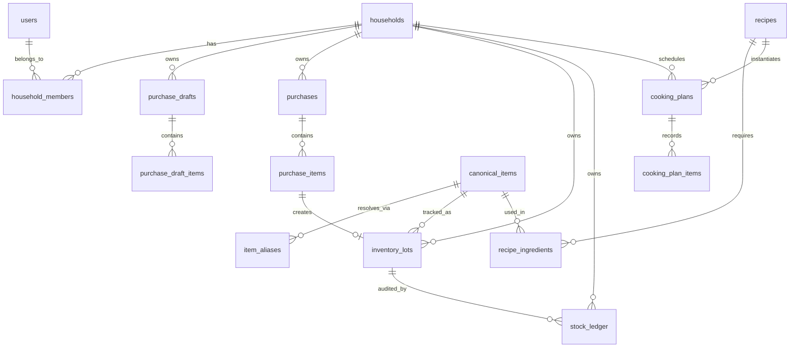

# Data Model & PostgreSQL Schema — GroceryManagement-AgentBenchmark

**Target Engine:** Neon PostgreSQL 17+  
**Extensions Required:** `pgcrypto` (for `gen_random_uuid()`, enabled by default on Neon).  
**Extensions Explicitly Excluded:** `pgvector` (rejected), `pg_trgm` (deferred; not required for MVP).

---

## 1. Entity-Relationship Overview



---

## 2. Schema Design Decisions & Trade-Offs

1. **Money in Integer Paise (`BIGINT`)**: Every monetary column uses `BIGINT` representing 1/100th of INR (`1 INR = 100 paise`). No `FLOAT`, `REAL`, or `DOUBLE PRECISION` is used for money.
2. **Quantities in Metric Base Units (`NUMERIC(12, 3)`)**: All inventory, ledger, and recipe quantities use `base_unit IN ('g', 'ml', 'pcs')` with `NUMERIC(12, 3)` precision to support both whole counts (`1.000 pcs`) and fractional weights (`0.500 g` spices).
3. **Immutable `stock_ledger`**: Enforced at the database layer via a `BEFORE UPDATE OR DELETE` trigger (`prevent_stock_ledger_mutation()`). Corrections must be appended as compensating entries (`ADJUSTMENT_IN` / `ADJUSTMENT_OUT`).
4. **Row-Level Security (RLS)**: All household-scoped tables enable `ROW LEVEL SECURITY` and enforce `household_id = current_setting('app.current_household_id', true)::uuid`. Shared catalog tables (`canonical_items`, `item_aliases`, `recipes`) allow reading global rows (`household_id IS NULL`) plus the active household's rows.
5. **Advisory Lock + `FOR UPDATE` for FEFO**: Concurrent deductions for the same `(household_id, canonical_item_id)` serialize on `pg_advisory_xact_lock(hashtextextended(household_id::text || ':' || canonical_item_id::text, 0))` and lock candidate rows with `FOR UPDATE`.

---

## 3. Complete DDL Specification

### 3.1 Extensions & Enum Types

```sql
CREATE EXTENSION IF NOT EXISTS pgcrypto;

CREATE TYPE base_unit_enum AS ENUM ('g', 'ml', 'pcs');
CREATE TYPE household_role_enum AS ENUM ('owner', 'member');
CREATE TYPE draft_status_enum AS ENUM ('draft', 'confirmed', 'discarded');
CREATE TYPE match_confidence_enum AS ENUM ('exact_alias', 'fuzzy_alias', 'user_selected', 'unmatched');
CREATE TYPE lot_status_enum AS ENUM ('active', 'depleted', 'expired', 'written_off');
CREATE TYPE ledger_event_enum AS ENUM (
    'PURCHASE_IN',
    'COOK_OUT',
    'ADJUSTMENT_IN',
    'ADJUSTMENT_OUT',
    'WASTE_OUT'
);
CREATE TYPE cooking_status_enum AS ENUM ('planned', 'in_progress', 'completed', 'cancelled');
```

### 3.2 Identity & Household Tenancy

```sql
CREATE TABLE users (
    id              UUID PRIMARY KEY DEFAULT gen_random_uuid(),
    email           TEXT NOT NULL UNIQUE,
    password_hash   TEXT NOT NULL,
    display_name    TEXT NOT NULL,
    is_dev_user     BOOLEAN NOT NULL DEFAULT FALSE,
    created_at      TIMESTAMPTZ NOT NULL DEFAULT now(),
    updated_at      TIMESTAMPTZ NOT NULL DEFAULT now()
);

CREATE TABLE households (
    id              UUID PRIMARY KEY DEFAULT gen_random_uuid(),
    name            TEXT NOT NULL,
    currency_code   CHAR(3) NOT NULL DEFAULT 'INR',
    created_by      UUID NOT NULL REFERENCES users(id) ON DELETE RESTRICT,
    created_at      TIMESTAMPTZ NOT NULL DEFAULT now(),
    updated_at      TIMESTAMPTZ NOT NULL DEFAULT now()
);

CREATE TABLE household_members (
    id              UUID PRIMARY KEY DEFAULT gen_random_uuid(),
    household_id    UUID NOT NULL REFERENCES households(id) ON DELETE CASCADE,
    user_id         UUID NOT NULL REFERENCES users(id) ON DELETE CASCADE,
    role            household_role_enum NOT NULL DEFAULT 'owner',
    joined_at       TIMESTAMPTZ NOT NULL DEFAULT now(),
    UNIQUE (household_id, user_id)
);

CREATE INDEX idx_household_members_user ON household_members(user_id);
```

### 3.3 Canonical Grocery Catalog & Deterministic Aliases

```sql
CREATE TABLE canonical_items (
    id                      UUID PRIMARY KEY DEFAULT gen_random_uuid(),
    household_id            UUID REFERENCES households(id) ON DELETE CASCADE, -- NULL = global system catalog
    slug                    TEXT NOT NULL,
    name                    TEXT NOT NULL,
    category                TEXT NOT NULL, -- e.g., 'dairy', 'produce', 'grains', 'spices', 'beverages'
    default_base_unit       base_unit_enum NOT NULL,
    default_pack_qty        NUMERIC(12, 3) CHECK (default_pack_qty IS NULL OR default_pack_qty > 0),
    default_pack_unit       base_unit_enum,
    default_shelf_life_days INTEGER CHECK (default_shelf_life_days IS NULL OR default_shelf_life_days > 0),
    low_stock_threshold_qty NUMERIC(12, 3) NOT NULL DEFAULT 0 CHECK (low_stock_threshold_qty >= 0),
    created_at              TIMESTAMPTZ NOT NULL DEFAULT now()
);

-- Global slugs unique; household custom slugs unique per household
CREATE UNIQUE INDEX uq_canonical_items_global_slug
    ON canonical_items(slug) WHERE household_id IS NULL;
CREATE UNIQUE INDEX uq_canonical_items_household_slug
    ON canonical_items(household_id, slug) WHERE household_id IS NOT NULL;

CREATE TABLE item_aliases (
    id                  UUID PRIMARY KEY DEFAULT gen_random_uuid(),
    household_id        UUID REFERENCES households(id) ON DELETE CASCADE, -- NULL = global alias
    canonical_item_id   UUID NOT NULL REFERENCES canonical_items(id) ON DELETE CASCADE,
    normalized_alias    TEXT NOT NULL, -- lowercased, trimmed, punctuation-stripped
    source              TEXT NOT NULL DEFAULT 'system', -- 'system' | 'user_confirmed'
    created_at          TIMESTAMPTZ NOT NULL DEFAULT now()
);

CREATE UNIQUE INDEX uq_item_aliases_global
    ON item_aliases(normalized_alias) WHERE household_id IS NULL;
CREATE UNIQUE INDEX uq_item_aliases_household
    ON item_aliases(household_id, normalized_alias) WHERE household_id IS NOT NULL;
CREATE INDEX idx_item_aliases_canonical ON item_aliases(canonical_item_id);
```

### 3.4 Purchases & OCR Drafts (Draft-Review-Confirm Boundary)

```sql
CREATE TABLE purchase_drafts (
    id                  UUID PRIMARY KEY DEFAULT gen_random_uuid(),
    household_id        UUID NOT NULL REFERENCES households(id) ON DELETE CASCADE,
    created_by          UUID NOT NULL REFERENCES users(id) ON DELETE RESTRICT,
    status              draft_status_enum NOT NULL DEFAULT 'draft',
    source_type         TEXT NOT NULL DEFAULT 'ocr', -- 'ocr' | 'manual'
    ocr_adapter         TEXT,
    merchant_name       TEXT,
    purchased_on        DATE NOT NULL DEFAULT CURRENT_DATE,
    currency_code       CHAR(3) NOT NULL DEFAULT 'INR',
    total_amount_paise  BIGINT NOT NULL DEFAULT 0 CHECK (total_amount_paise >= 0),
    raw_ocr_payload     JSONB,
    confirmed_at        TIMESTAMPTZ,
    created_at          TIMESTAMPTZ NOT NULL DEFAULT now(),
    updated_at          TIMESTAMPTZ NOT NULL DEFAULT now()
);

CREATE INDEX idx_purchase_drafts_household_status
    ON purchase_drafts(household_id, status, created_at DESC);

CREATE TABLE purchase_draft_items (
    id                  UUID PRIMARY KEY DEFAULT gen_random_uuid(),
    draft_id            UUID NOT NULL REFERENCES purchase_drafts(id) ON DELETE CASCADE,
    household_id        UUID NOT NULL REFERENCES households(id) ON DELETE CASCADE,
    line_index          INTEGER NOT NULL CHECK (line_index >= 0),
    raw_text            TEXT NOT NULL,
    canonical_item_id   UUID REFERENCES canonical_items(id) ON DELETE SET NULL,
    display_name        TEXT NOT NULL,
    match_confidence    match_confidence_enum NOT NULL DEFAULT 'unmatched',
    -- Raw extracted pack representation (Disagreement #4 boundary)
    pack_count          NUMERIC(10, 3) NOT NULL DEFAULT 1 CHECK (pack_count > 0),
    pack_size_value     NUMERIC(10, 3) CHECK (pack_size_value IS NULL OR pack_size_value > 0),
    pack_size_unit      TEXT, -- raw extracted unit e.g. 'kg', 'ml', 'pack'
    -- Normalized base unit representation
    normalized_qty      NUMERIC(12, 3) NOT NULL CHECK (normalized_qty > 0),
    base_unit           base_unit_enum NOT NULL,
    needs_unit_review   BOOLEAN NOT NULL DEFAULT FALSE,
    -- Integer paise (Disagreement #3 boundary)
    unit_price_paise    BIGINT NOT NULL DEFAULT 0 CHECK (unit_price_paise >= 0),
    line_total_paise    BIGINT NOT NULL DEFAULT 0 CHECK (line_total_paise >= 0),
    expires_on          DATE,
    created_at          TIMESTAMPTZ NOT NULL DEFAULT now()
);

CREATE INDEX idx_purchase_draft_items_draft ON purchase_draft_items(draft_id, line_index);

CREATE TABLE purchases (
    id                  UUID PRIMARY KEY DEFAULT gen_random_uuid(),
    household_id        UUID NOT NULL REFERENCES households(id) ON DELETE CASCADE,
    draft_id            UUID UNIQUE REFERENCES purchase_drafts(id) ON DELETE SET NULL,
    created_by          UUID NOT NULL REFERENCES users(id) ON DELETE RESTRICT,
    merchant_name       TEXT,
    purchased_on        DATE NOT NULL,
    currency_code       CHAR(3) NOT NULL DEFAULT 'INR',
    total_amount_paise  BIGINT NOT NULL CHECK (total_amount_paise >= 0),
    created_at          TIMESTAMPTZ NOT NULL DEFAULT now()
);

CREATE INDEX idx_purchases_household_date ON purchases(household_id, purchased_on DESC);

CREATE TABLE purchase_items (
    id                  UUID PRIMARY KEY DEFAULT gen_random_uuid(),
    purchase_id         UUID NOT NULL REFERENCES purchases(id) ON DELETE CASCADE,
    household_id        UUID NOT NULL REFERENCES households(id) ON DELETE CASCADE,
    canonical_item_id   UUID NOT NULL REFERENCES canonical_items(id) ON DELETE RESTRICT,
    display_name        TEXT NOT NULL,
    normalized_qty      NUMERIC(12, 3) NOT NULL CHECK (normalized_qty > 0),
    base_unit           base_unit_enum NOT NULL,
    unit_price_paise    BIGINT NOT NULL CHECK (unit_price_paise >= 0),
    line_total_paise    BIGINT NOT NULL CHECK (line_total_paise >= 0),
    expires_on          DATE,
    created_at          TIMESTAMPTZ NOT NULL DEFAULT now()
);

CREATE INDEX idx_purchase_items_purchase ON purchase_items(purchase_id);
CREATE INDEX idx_purchase_items_household_item ON purchase_items(household_id, canonical_item_id);
```

### 3.5 Lot-Based Inventory & Append-Only Stock Ledger

```sql
CREATE TABLE inventory_lots (
    id                  UUID PRIMARY KEY DEFAULT gen_random_uuid(),
    household_id        UUID NOT NULL REFERENCES households(id) ON DELETE CASCADE,
    canonical_item_id   UUID NOT NULL REFERENCES canonical_items(id) ON DELETE RESTRICT,
    purchase_item_id    UUID UNIQUE REFERENCES purchase_items(id) ON DELETE SET NULL,
    initial_qty         NUMERIC(12, 3) NOT NULL CHECK (initial_qty > 0),
    remaining_qty       NUMERIC(12, 3) NOT NULL CHECK (remaining_qty >= 0 AND remaining_qty <= initial_qty),
    base_unit           base_unit_enum NOT NULL,
    unit_cost_paise     BIGINT NOT NULL DEFAULT 0 CHECK (unit_cost_paise >= 0),
    received_at         TIMESTAMPTZ NOT NULL DEFAULT now(),
    expires_on          DATE,
    lot_status          lot_status_enum NOT NULL DEFAULT 'active',
    created_at          TIMESTAMPTZ NOT NULL DEFAULT now(),
    updated_at          TIMESTAMPTZ NOT NULL DEFAULT now()
);

-- Critical FEFO composite index: supports ORDER BY expires_on ASC NULLS LAST, received_at ASC, id ASC
CREATE INDEX idx_inventory_lots_fefo
    ON inventory_lots(household_id, canonical_item_id, lot_status, expires_on ASC NULLS LAST, received_at ASC, id ASC)
    WHERE remaining_qty > 0 AND lot_status = 'active';

CREATE INDEX idx_inventory_lots_expiring
    ON inventory_lots(household_id, expires_on ASC)
    WHERE remaining_qty > 0 AND lot_status = 'active' AND expires_on IS NOT NULL;

CREATE TABLE stock_ledger (
    id                  UUID PRIMARY KEY DEFAULT gen_random_uuid(),
    household_id        UUID NOT NULL REFERENCES households(id) ON DELETE CASCADE,
    lot_id              UUID NOT NULL REFERENCES inventory_lots(id) ON DELETE RESTRICT,
    canonical_item_id   UUID NOT NULL REFERENCES canonical_items(id) ON DELETE RESTRICT,
    event_type          ledger_event_enum NOT NULL,
    quantity_delta      NUMERIC(12, 3) NOT NULL CHECK (quantity_delta <> 0),
    base_unit           base_unit_enum NOT NULL,
    balance_after_lot   NUMERIC(12, 3) NOT NULL CHECK (balance_after_lot >= 0),
    reference_type      TEXT, -- 'purchase_item' | 'cooking_plan' | 'manual_adjustment' | 'spoilage'
    reference_id        UUID,
    actor_user_id       UUID NOT NULL REFERENCES users(id) ON DELETE RESTRICT,
    notes               TEXT,
    created_at          TIMESTAMPTZ NOT NULL DEFAULT now()
);

CREATE INDEX idx_stock_ledger_household_created
    ON stock_ledger(household_id, created_at DESC);
CREATE INDEX idx_stock_ledger_lot
    ON stock_ledger(lot_id, created_at ASC);
CREATE INDEX idx_stock_ledger_item
    ON stock_ledger(household_id, canonical_item_id, created_at DESC);
```

#### Immutability Trigger on `stock_ledger`

```sql
CREATE OR REPLACE FUNCTION prevent_stock_ledger_mutation()
RETURNS TRIGGER AS $$
BEGIN
    RAISE EXCEPTION 'stock_ledger is append-only; UPDATE and DELETE are forbidden (code=IMMUTABLE_LEDGER)'
        USING ERRCODE = '42501';
END;
$$ LANGUAGE plpgsql;

CREATE TRIGGER trg_stock_ledger_immutable
    BEFORE UPDATE OR DELETE ON stock_ledger
    FOR EACH ROW
    EXECUTE FUNCTION prevent_stock_ledger_mutation();
```

### 3.6 Recipes & Cooking Plans

```sql
CREATE TABLE recipes (
    id              UUID PRIMARY KEY DEFAULT gen_random_uuid(),
    household_id    UUID REFERENCES households(id) ON DELETE CASCADE, -- NULL = global curated recipe
    slug            TEXT NOT NULL,
    title           TEXT NOT NULL,
    description     TEXT,
    servings        INTEGER NOT NULL DEFAULT 2 CHECK (servings > 0),
    prep_minutes    INTEGER NOT NULL DEFAULT 15 CHECK (prep_minutes >= 0),
    instructions    JSONB NOT NULL DEFAULT '[]'::jsonb,
    created_at      TIMESTAMPTZ NOT NULL DEFAULT now()
);

CREATE UNIQUE INDEX uq_recipes_global_slug
    ON recipes(slug) WHERE household_id IS NULL;
CREATE UNIQUE INDEX uq_recipes_household_slug
    ON recipes(household_id, slug) WHERE household_id IS NOT NULL;

CREATE TABLE recipe_ingredients (
    id                  UUID PRIMARY KEY DEFAULT gen_random_uuid(),
    recipe_id           UUID NOT NULL REFERENCES recipes(id) ON DELETE CASCADE,
    canonical_item_id   UUID NOT NULL REFERENCES canonical_items(id) ON DELETE RESTRICT,
    required_qty        NUMERIC(12, 3) NOT NULL CHECK (required_qty > 0),
    base_unit           base_unit_enum NOT NULL,
    is_optional         BOOLEAN NOT NULL DEFAULT FALSE,
    UNIQUE (recipe_id, canonical_item_id)
);

CREATE TABLE cooking_plans (
    id                  UUID PRIMARY KEY DEFAULT gen_random_uuid(),
    household_id        UUID NOT NULL REFERENCES households(id) ON DELETE CASCADE,
    recipe_id           UUID NOT NULL REFERENCES recipes(id) ON DELETE RESTRICT,
    created_by          UUID NOT NULL REFERENCES users(id) ON DELETE RESTRICT,
    status              cooking_status_enum NOT NULL DEFAULT 'planned',
    planned_servings    INTEGER NOT NULL CHECK (planned_servings > 0),
    started_at          TIMESTAMPTZ NOT NULL DEFAULT now(),
    completed_at        TIMESTAMPTZ,
    cancelled_at        TIMESTAMPTZ
);

CREATE INDEX idx_cooking_plans_household_status
    ON cooking_plans(household_id, status, started_at DESC);

CREATE TABLE cooking_plan_items (
    id                  UUID PRIMARY KEY DEFAULT gen_random_uuid(),
    cooking_plan_id     UUID NOT NULL REFERENCES cooking_plans(id) ON DELETE CASCADE,
    household_id        UUID NOT NULL REFERENCES households(id) ON DELETE CASCADE,
    canonical_item_id   UUID NOT NULL REFERENCES canonical_items(id) ON DELETE RESTRICT,
    planned_qty         NUMERIC(12, 3) NOT NULL CHECK (planned_qty > 0),
    actual_used_qty     NUMERIC(12, 3) CHECK (actual_used_qty IS NULL OR actual_used_qty >= 0),
    base_unit           base_unit_enum NOT NULL,
    UNIQUE (cooking_plan_id, canonical_item_id)
);
```

### 3.7 Idempotency Keys

```sql
CREATE TABLE idempotency_keys (
    id              UUID PRIMARY KEY DEFAULT gen_random_uuid(),
    household_id    UUID NOT NULL REFERENCES households(id) ON DELETE CASCADE,
    idempotency_key TEXT NOT NULL,
    endpoint        TEXT NOT NULL,
    request_hash    TEXT NOT NULL,
    response_status INTEGER NOT NULL,
    response_body   JSONB NOT NULL,
    created_at      TIMESTAMPTZ NOT NULL DEFAULT now(),
    expires_at      TIMESTAMPTZ NOT NULL DEFAULT (now() + INTERVAL '24 hours'),
    UNIQUE (household_id, idempotency_key, endpoint)
);

CREATE INDEX idx_idempotency_expires ON idempotency_keys(expires_at);
```

---

## 4. Row-Level Security (RLS) Policies

On every authenticated request, the backend sets:
`SELECT set_config('app.current_household_id', '<uuid>', true);`

```sql
-- Pure tenant-owned tables
ALTER TABLE purchase_drafts ENABLE ROW LEVEL SECURITY;
ALTER TABLE purchase_draft_items ENABLE ROW LEVEL SECURITY;
ALTER TABLE purchases ENABLE ROW LEVEL SECURITY;
ALTER TABLE purchase_items ENABLE ROW LEVEL SECURITY;
ALTER TABLE inventory_lots ENABLE ROW LEVEL SECURITY;
ALTER TABLE stock_ledger ENABLE ROW LEVEL SECURITY;
ALTER TABLE cooking_plans ENABLE ROW LEVEL SECURITY;
ALTER TABLE cooking_plan_items ENABLE ROW LEVEL SECURITY;
ALTER TABLE idempotency_keys ENABLE ROW LEVEL SECURITY;

-- Policy template for pure tenant tables
CREATE POLICY tenant_isolation_purchase_drafts ON purchase_drafts
    USING (household_id = NULLIF(current_setting('app.current_household_id', true), '')::uuid)
    WITH CHECK (household_id = NULLIF(current_setting('app.current_household_id', true), '')::uuid);
-- (Identical policy applied to purchase_draft_items, purchases, purchase_items,
--  inventory_lots, stock_ledger, cooking_plans, cooking_plan_items, idempotency_keys)

-- Shared + tenant-custom tables (canonical_items, item_aliases, recipes)
ALTER TABLE canonical_items ENABLE ROW LEVEL SECURITY;
CREATE POLICY catalog_read ON canonical_items FOR SELECT
    USING (
        household_id IS NULL
        OR household_id = NULLIF(current_setting('app.current_household_id', true), '')::uuid
    );
CREATE POLICY catalog_write ON canonical_items FOR ALL
    USING (household_id = NULLIF(current_setting('app.current_household_id', true), '')::uuid)
    WITH CHECK (household_id = NULLIF(current_setting('app.current_household_id', true), '')::uuid);
```

> [!IMPORTANT]
> The application DB role used by FastAPI MUST NOT have `BYPASSRLS` or superuser privileges in Neon. Migrations run under the owner/migration role; runtime requests run under a least-privilege app role so RLS is genuinely enforced by PostgreSQL.

---

## 5. Migration & Rollback Strategy

- **Tooling**: Alembic (`backend/alembic/`) using forward-only versioned migrations in CI/CD, with explicit `downgrade()` functions for dev/staging rollback.
- **Migration Order**:
  1. `0001_extensions_and_enums.py`
  2. `0002_auth_and_households.py`
  3. `0003_catalog_and_aliases.py` + `seed_global_catalog.py` (idempotent upsert)
  4. `0004_purchases_and_drafts.py`
  5. `0005_inventory_lots_and_ledger.py` (includes `trg_stock_ledger_immutable`)
  6. `0006_recipes_and_cooking_plans.py` + `seed_global_recipes.py`
  7. `0007_idempotency_and_rls.py`
